  <a href="https://camomille-artwork.com"> `` &lt;img src="./profile/banner.svg" width="100%" alt="camomille artwork" /&gt; ``</a>

<h1 align="center">Camila Santos · camomille</h1>

<h3 align="center">I design how products <em>move</em>, <em>feel</em>, and <em>respond</em>.</h3>

Product & Motion Designer · São Paulo, Brazil

  
  <a href="https://www.linkedin.com/in/camilasantos1294/"> ` &lt;img src="https://img.shields.io/badge/LinkedIn-241C49?style=for-the-badge&logo=data%3Aimage%2Fsvg%2Bxml%3Bbase64%2CPHN2ZyB2aWV3Qm94PSIwIDAgMjQgMjQiIHhtbG5zPSJodHRwOi8vd3d3LnczLm9yZy8yMDAwL3N2ZyI%2BPHBhdGggZmlsbD0id2hpdGUiIGQ9Ik0yMC40NDcgMjAuNDUyaC0zLjU1NHYtNS41NjljMC0xLjMyOC0uMDI3LTMuMDM3LTEuODUyLTMuMDM3LTEuODUzIDAtMi4xMzYgMS40NDUtMi4xMzYgMi45Mzl2NS42NjdIOS4zNTFWOWgzLjQxNHYxLjU2MWguMDQ2Yy40NzctLjkgMS42MzctMS44NSAzLjM3LTEuODUgMy42MDEgMCA0LjI2NyAyLjM3IDQuMjY3IDUuNDU1djYuMjg2ek01LjMzNyA3LjQzM2MtMS4xNDQgMC0yLjA2My0uOTI2LTIuMDYzLTIuMDY1IDAtMS4xMzguOTItMi4wNjMgMi4wNjMtMi4wNjMgMS4xNCAwIDIuMDY0LjkyNSAyLjA2NCAyLjA2MyAwIDEuMTM5LS45MjUgMi4wNjUtMi4wNjQgMi4wNjV6bTEuNzgyIDEzLjAxOUgzLjU1NVY5aDMuNTY0djExLjQ1MnpNMjIuMjI1IDBIMS43NzFDLjc5MiAwIDAgLjc3NCAwIDEuNzI5djIwLjU0MkMwIDIzLjIyNy43OTIgMjQgMS43NzEgMjRoMjAuNDUxQzIzLjIgMjQgMjQgMjMuMjI3IDI0IDIyLjI3MVYxLjcyOUMyNCAuNzc0IDIzLjIgMCAyMi4yMjIgMGguMDAzeiIvPjwvc3ZnPg%3D%3D" alt="LinkedIn" /&gt; `</a>
  
  
  

Designing since 2014 across UX/UI, motion, and illustration, with the eye of a product designer and the hands-on rigor of a front-end developer.

I focus on visual, motion, and systems that connect usability to visual value: microinteractions, prototypes, and design systems that stay consistent as teams grow. I care deeply about accessibility and diversity in UX.

## ✨ What I do

- 🎞️ **Motion and microinteractions.** Motion languages, style guides, and interaction details that give a product its rhythm, built in After Effects, Lottie, and Rive.
- 🎨 **Illustration systems.** Visual identities and illustration libraries with clear rules, diverse representation, and room to scale.
- 🧩 **Design systems and prototyping.** Components, tokens, and high-fidelity prototypes in Figma and ProtoPie, measured against real user journeys.
- 💻 **Design that ships.** Hands-on HTML, CSS, and React, so what I design survives the handoff. My portfolio is hand-built in Astro.

## 🏢 Where I work

  <a href="https://github.com/itau"> `` &lt;img src="./profile/org-itau.svg" align="left" width="48" height="48" alt="Itaú Unibanco logo" /&gt; ``</a>
  <strong><a href="https://github.com/itau">Itaú Unibanco</a></strong>
   
  Product & Motion Designer.

 

## 🚀 Selected work

  <a href="https://camomille-artwork.com/work/rd-station"> ` &lt;img src="./profile/pin-rd-station.svg" width="400" alt="Motion Design Style Guide, RD Station" /&gt; `</a>
  <a href="https://github.com/camomiIIe/portfolio-camomille"> `` &lt;img src="./profile/pin-portfolio-camomille.svg" width="400" alt="portfolio-camomille" /&gt; ``</a>

- **[Motion Design Style Guide](https://camomille-artwork.com/work/rd-station), RD Station (2021).** Turning a brand book into a shared motion language, so any designer on the team could ship work that felt unmistakably RD. Five brand attributes, five motion behaviors, one reference for everyone.
- **[portfolio-camomille](https://github.com/camomiIIe/portfolio-camomille).** My portfolio, designed and built by me. Astro, MDX case studies, handcrafted CSS with design tokens, and Lottie for motion.

## 🛠️ Toolkit

**Design and prototyping**

**Motion**

**Front-end**

## 📊 GitHub activity

  
  

  

## 🎧 On repeat

Rhythm and timing start with what's playing. Here's what I've been listening to:

  <a href="https://www.last.fm/user/camomiIIe"> `` &lt;img src="https://lastfm-recently-played.jeffreyca.workers.dev/svg?user=camomiIIe&theme=dark&bg_color=241C49&text_color=FFFFFF&artist_color=FFD44A&meta_color=B9B6D3&accent_color=E91E8C&loved_color=E91E8C&logo_color=FFFFFF&loved=title&stats=block&count=3&width=800" alt="Recently played on Last.fm" /&gt; ``</a>

## 🤝 Working together

Alongside my full-time role, I take on a few freelance projects: motion and Lottie animation, illustration systems, design systems, and interactive prototyping. Remote from São Paulo, with hours that overlap the Americas and Europe.

Got a project? *Let's talk.* Message me on [LinkedIn](https://www.linkedin.com/in/camilasantos1294/) or see more at [camomille-artwork.com](https://camomille-artwork.com).
